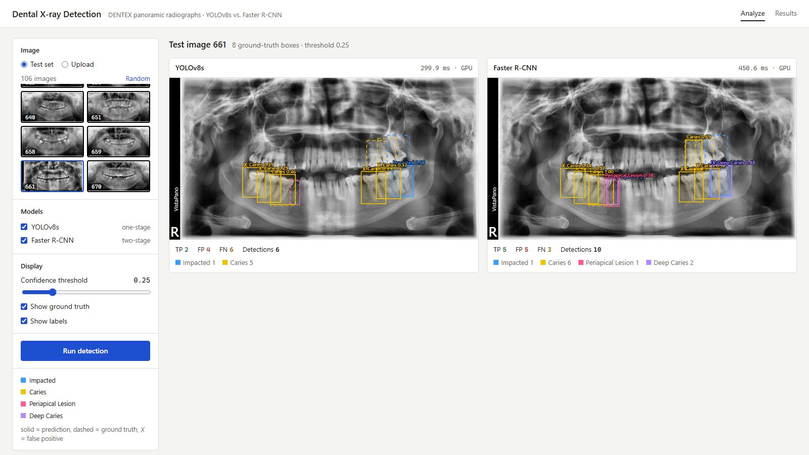
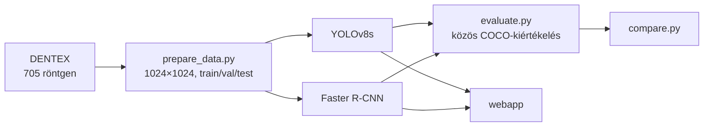
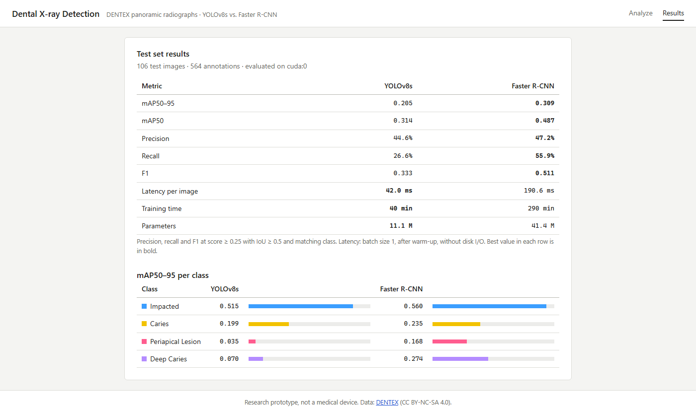

# Fogászati röntgenképek elemzése: YOLOv8s vs. Faster R-CNN


-555555)

Két objektumdetektort hasonlítunk össze, amelyek fogászati **panorámaröntgen-felvételeken** keresik meg és keretezik be a négyféle eltérést: egy egylépéses **YOLOv8s** és egy kétlépéses **Faster R-CNN** modellt. A repó tartalmazza a teljes folyamatot az adat-előkészítéstől a tanításon és a közös kiértékelésen át az egy képen futó predikcióig, valamint egy egyszerű webes felületet, ahol a két modell egymás mellett futtatható.



> [!IMPORTANT]
> Egyetemi projekt, **nem orvostechnikai eszköz**, és nem helyettesíti a fogorvost. A célja az, hogy segítsen a röntgenképek előszűrésében és az esetleges elváltozások megjelölésében.

## Tartalom

- [A feladat](#a-feladat)
- [Adathalmaz](#adathalmaz)
- [Modellek](#modellek)
- [Eredmények](#eredmények)
- [Webes felület](#webes-felület)
- [Telepítés és használat](#telepítés-és-használat)
- [Projektszerkezet](#projektszerkezet)
- [Korlátok](#korlátok)
- [Készítők](#készítők)
- [Hivatkozások és licencek](#hivatkozások-és-licencek)

## A feladat

A modellek bekeretezik a rendellenes fogakat, és minden kerethez diagnóziscímkét és pontszámot adnak:

| Osztály (DENTEX) | Magyarul |
| --- | --- |
| `Impacted` | beékelődött fog |
| `Caries` | szuvasodás |
| `Periapical Lesion` | gyökércsúcs körüli elváltozás |
| `Deep Caries` | mély szuvasodás |

## Adathalmaz

A [DENTEX](https://github.com/ibrahimethemhamamci/DENTEX) (MICCAI 2023 Challenge) `quadrant-enumeration-disease` részhalmazát használjuk: **705 annotált panorámaröntgen**, 3529 jelölés.

| | Tanító | Validációs | Teszt |
| --- | ---: | ---: | ---: |
| Képek | 493 | 106 | 106 |

- Rögzített, véletlen, képszintű felosztás (`seed=42`).
- Aránytartó átméretezés 1024×1024-re, szürke kitöltéssel (letterbox).
- Mindkét modell ugyanazokat a képeket kapja. A címkék YOLO és COCO formátumban is elkészülnek.
- A legjobb epochot a validációs halmaz alapján választjuk ki. A teszthalmazt csak a végső összehasonlításhoz használjuk.

## Modellek

| Modell | Típus | Paraméterek | Megvalósítás |
| --- | --- | ---: | --- |
| YOLOv8s | egylépéses | 11,1 M | Ultralytics |
| Faster R-CNN, ResNet-50 FPN | kétlépéses (RPN, utána osztályozás) | 41,4 M | Torchvision |

Mindkét modell COCO-n előtanított súlyokból indul, és a DENTEX-en van finomhangolva, 50 epochon át. Kiértékelésre mindkettő **ugyanazt a COCO-kiértékelőt** használja, így a számok közvetlenül összevethetők.



## Eredmények

Teszthalmaz: 106 kép, 564 annotáció. A modellek NVIDIA RTX 3050 (6 GB, laptop) GPU-n tanultak.

| Mérőszám | YOLOv8s | Faster R-CNN |
| --- | ---: | ---: |
| mAP50–95 | 0,205 | **0,309** |
| mAP50 | 0,314 | **0,487** |
| Precision | 44,6% | **47,2%** |
| Recall | 26,6% | **55,9%** |
| F1 | 0,333 | **0,511** |
| Késleltetés / kép | **42,0 ms** | 190,6 ms |
| Tanítási idő | **40 perc** | 4 óra 50 perc |

Precision, recall és F1: 0,25-ös pontszámküszöb, IoU ≥ 0,5, osztályhelyes párosítás. A késleltetést batch=1 mellett, bemelegítés után, GPU-szinkronizálással mértük.

**mAP50–95 osztályonként**

| Osztály | YOLOv8s | Faster R-CNN |
| --- | ---: | ---: |
| Impacted | 0,515 | **0,560** |
| Caries | 0,199 | **0,235** |
| Periapical Lesion | 0,035 | **0,168** |
| Deep Caries | 0,070 | **0,274** |



**Összefoglalva:**

- A **Faster R-CNN** minden pontossági mérőszámban jobb, legnagyobb előnye a recallban van. A gyökércsúcs körüli elváltozást és a mély szuvasodást lényegesen jobban felismeri.
- A **YOLOv8s** kb. **4,5-ször gyorsabb** a predikcióban, és körülbelül hétszer gyorsabban tanul, ezért interaktív használatra kényelmesebb.
- Mindkét modellnek a beékelődött fog a legkönnyebb osztály, a gyökércsúcs körüli elváltozás pedig a legnehezebb, ami a kevés tanítópéldával is összefügg.

Részletes szakmai beszámoló: [docs/beszamolo.md](docs/beszamolo.md). A tanulási görbék és a példaképek a [reports/figures/](reports/figures/) mappában vannak.

## Webes felület

Egy kis Flask-alkalmazás, egyetlen HTML-oldallal. Nincs build lépés, és internet sem kell hozzá.

```bash
python -m webapp.app            # http://127.0.0.1:5000
python -m webapp.app --preload  # a modellek betöltése már indításkor
```

- Választhatsz egy tesztképet a 106 közül, vagy feltölthetsz saját panorámaröntgent.
- A kiválasztott modellek egymás mellett elemzik ugyanazt a képet, a futási idővel együtt.
- A valós annotáció szaggatott, a predikció folytonos vonallal látszik, a téves jelölést ✗ jelöli.
- A TP / FP / FN értékek a konfidenciaküszöb csúszkájával élőben frissülnek.
- A *Results* fül az `evaluate.py` által mentett teszteredményeket mutatja.

A modellek és a súlyfájlok útvonala a `config.json` `models` részében van megadva.

## Telepítés és használat

Minden parancsot a projekt gyökeréből kell futtatni. Python 3.10 vagy 3.11 ajánlott.

### 1. Környezet

```bash
python -m venv .venv
# Windows: .\.venv\Scripts\activate    Linux/macOS: source .venv/bin/activate

# A PyTorch verziót a géphez kell igazítani (https://pytorch.org/get-started/locally/), pl. CUDA 12.1:
pip install torch==2.5.1 torchvision==0.20.1 --index-url https://download.pytorch.org/whl/cu121

pip install -r requirements.txt
python -m unittest discover -s tests -v
```

A `"device": "auto"` beállítás CUDA GPU-t használ, ha van, különben CPU-t.

### 2. Adatok

Töltsd le a [DENTEX `training_data.zip`](https://zenodo.org/records/7812323) archívumot, és csomagold ki a projekt gyökerébe:

```text
training_data/
  quadrant-enumeration-disease/
    train_quadrant_enumeration_disease.json
    xrays/
```

```bash
python prepare_data.py   # -> data/prepared/
```

### 3. Tanítás

Az epochszám, a batchméret és a tanulási ráta a `config.json` fájlban állítható.

```bash
python -m yolo.train          # -> runs/yolo
python -m faster_rcnn.train   # -> runs/faster_rcnn
```

A két tanítást egymás után futtasd. A szkriptek nem írják felül a létező futásokat. Más YOLO-súlyokkal is lehet tanítani, például: `python -m yolo.train --model yolov8m.pt --name yolov8m`.

### 4. Kiértékelés és összehasonlítás

```bash
python evaluate.py --method yolo        --weights runs/yolo/weights/best.pt --label YOLOv8s
python evaluate.py --method faster_rcnn --weights runs/faster_rcnn/best.pth --label "Faster R-CNN"
python compare.py   # -> runs/comparison/comparison.md és .csv
```

A `compare.py` megtagadja az összehasonlítást, ha a futások más adatfelosztást, küszöböt vagy eszközt használtak.

### 5. Predikció egy képen

```bash
python predict.py --method faster_rcnn --weights runs/faster_rcnn/best.pth --image rontgen.png --output runs/demo/eredmeny.png --threshold 0.3
```

A kimenet egy bekeretezett kép és egy JSON-fájl az eredeti koordinátákkal. Ha nincs találat, abból nem következik, hogy a fogazat egészséges.

## Projektszerkezet

```text
common/            közös képfeldolgozás, inferencia és COCO-mérőszámok
yolo/train.py      YOLO-tanítás (Ultralytics)
faster_rcnn/       Faster R-CNN modell, adatbetöltő és tanítás (Torchvision)
webapp/            Flask szerver és statikus HTML/CSS/JS felület
tests/             adatfeldolgozási és kiértékelési tesztek szintetikus adattal
prepare_data.py    DENTEX -> közös 1024×1024 adathalmaz
evaluate.py        kiértékelés a teszthalmazon, késleltetésméréssel
compare.py         összehasonlító CSV és Markdown
predict.py         egy kép elemzése parancssorból
build_report.py    beszámoló és ábrák generálása a mentett eredményekből
config.json        útvonalak, tanítási és kiértékelési beállítások
docs/              beszámoló és képernyőképek
reports/           ábrák és elemzési táblák
```

A betanított súlyok (`runs/`) és az adatok (`data/`, `training_data/`) méretük miatt nincsenek a repóban.

## Korlátok

- Egyetlen seed és felosztás, 106 tesztkép. A különbségek nagysága tájékoztató jellegű.
- Képszintű felosztás. Az archívumban nincs betegazonosító, így a betegszintű elkülönítés nem garantált.
- Kiegyensúlyozatlan osztályok: gyökércsúcs körüli elváltozásból a tanítóhalmazban csak 117 példa van.
- Nincs augmentáció, és a két modell tanítási receptje (optimalizáló, batch, ütemezés) eltér.
- A pontszámok nem kalibrált klinikai valószínűségek. A modell nem ad leletet és fogszámozást sem.

## Készítők

- **[valentin-22-valentin](https://github.com/valentin-22-valentin)**
- **[Toth Szilard](https://github.com/Totocsy)**

## Hivatkozások és licencek

1. Ren S., He K., Girshick R., Sun J. *Faster R-CNN: Towards Real-Time Object Detection with Region Proposal Networks.* NeurIPS 2015. [link](https://papers.nips.cc/paper/2015/hash/14bfa6bb14875e45bba028a21ed38046-Abstract.html)
2. Hamamci I. E. et al. *DENTEX: An Abnormal Tooth Detection with Dental Enumeration and Diagnosis Benchmark for Panoramic X-rays.* arXiv:2305.19112. [link](https://arxiv.org/abs/2305.19112)
3. [Ultralytics YOLOv8 dokumentáció](https://docs.ultralytics.com/)
4. [Torchvision Faster R-CNN](https://docs.pytorch.org/vision/stable/models/generated/torchvision.models.detection.fasterrcnn_resnet50_fpn.html)

- **Kód:** [AGPL-3.0](LICENSE).
- **Adatok:** a DENTEX és a belőle készült ábrák, a képernyőképeket is beleértve, [CC BY-NC-SA 4.0](https://creativecommons.org/licenses/by-nc-sa/4.0/) licencűek. Csak nem kereskedelmi célra használhatók, a szerzők feltüntetésével. A képeken csak átméretezés, kivágás, keretek és feliratok hozzáadása történt.
- **Könyvtárak:** [Ultralytics](https://www.ultralytics.com/license) (AGPL-3.0), PyTorch / Torchvision (BSD), Flask (BSD).
