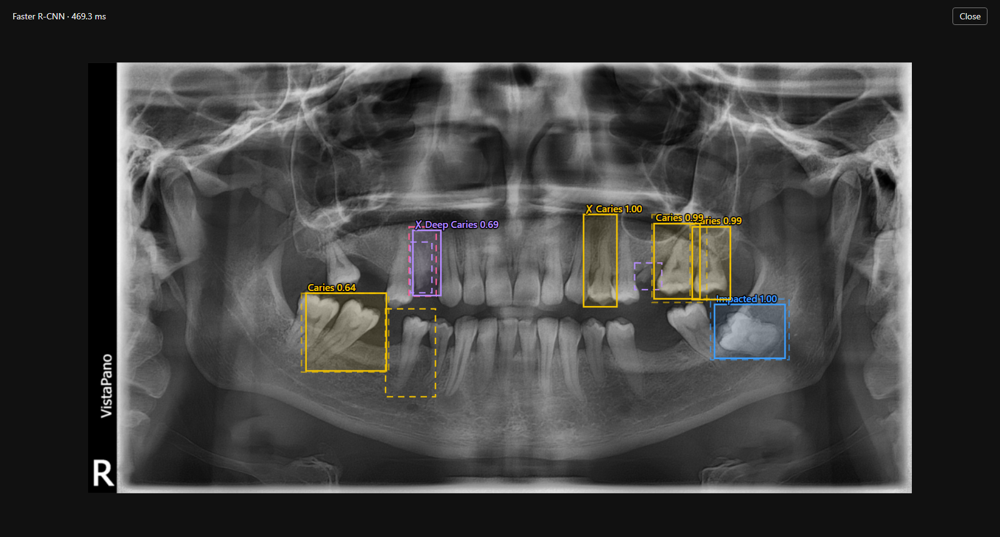
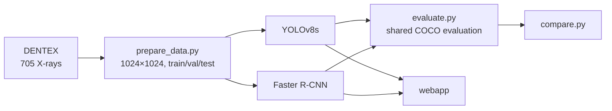
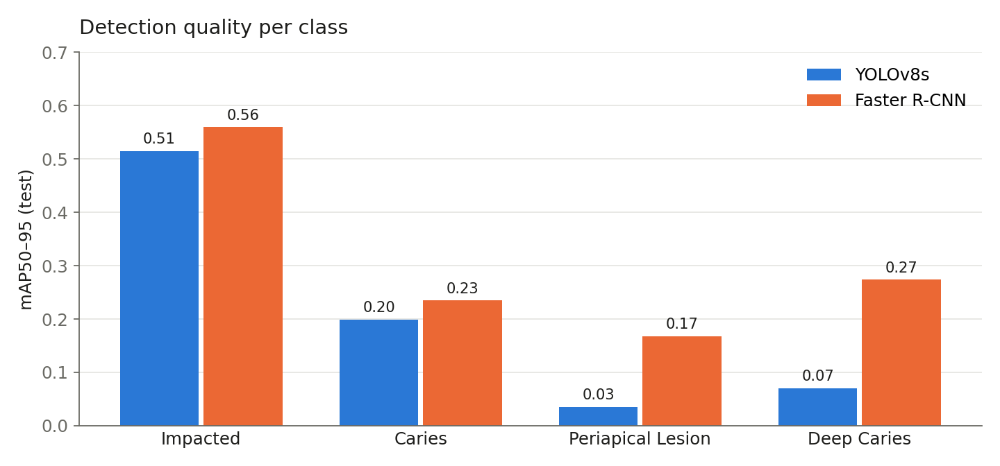
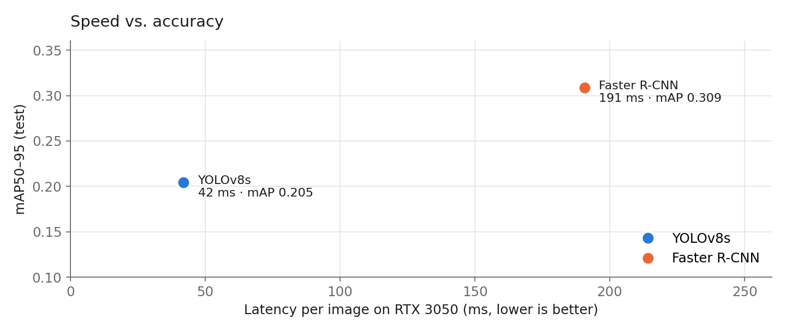
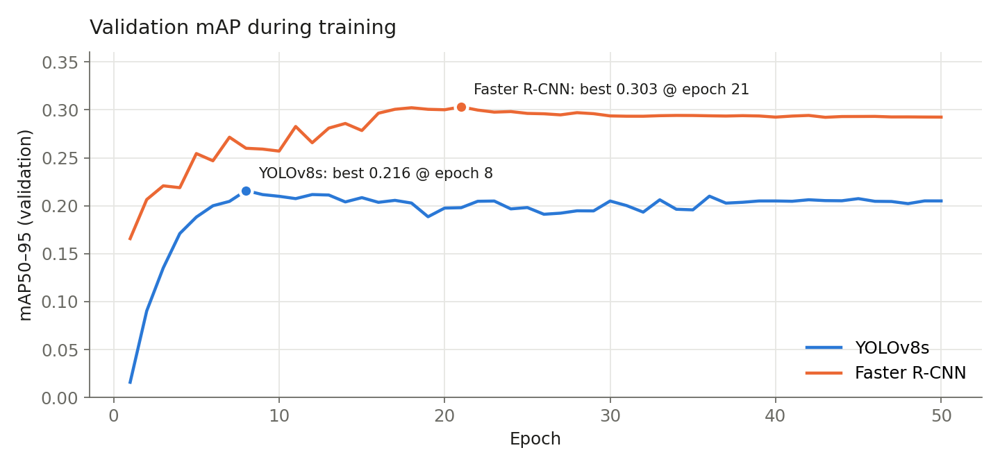

# Dental X-ray Anomaly Detection: YOLOv8s vs. Faster R-CNN


-555555)

This project compares two object detectors that find and label four kinds of dental anomalies on **panoramic X-rays**: the one-stage **YOLOv8s** and the two-stage **Faster R-CNN**. It covers the whole pipeline: data preparation, training, a shared evaluation, prediction on a single image, and a small web interface for running both models side by side.


> [!IMPORTANT]
> This is a university project, **not a medical device**, and it does not replace a dentist. It is meant to help with pre-screening radiographs and highlighting possible findings.

## Contents

- [The task](#the-task)
- [Dataset](#dataset)
- [Models](#models)
- [Results](#results)
- [Web interface](#web-interface)
- [Installation and usage](#installation-and-usage)
- [Project structure](#project-structure)
- [Limitations](#limitations)
- [Authors](#authors)
- [References and licenses](#references-and-licenses)

## The task

For every abnormal tooth, the model draws a bounding box and assigns one of four diagnoses with a confidence score:

| Class | Meaning |
| --- | --- |
| `Impacted` | a tooth that has not fully erupted and stays in the jaw bone |
| `Caries` | tooth decay |
| `Periapical Lesion` | an inflammatory lesion around the root tip |
| `Deep Caries` | advanced decay close to the pulp |

Below, Faster R-CNN is run on a test image. Solid boxes are predictions, dashed boxes are the dentists' annotations, and ✗ marks a false positive:



## Dataset

We use the `quadrant-enumeration-disease` subset of [DENTEX](https://github.com/ibrahimethemhamamci/DENTEX) (MICCAI 2023 Challenge): **705 annotated panoramic X-rays** with 3,529 labelled findings.

| | Train | Validation | Test |
| --- | ---: | ---: | ---: |
| Images | 493 | 106 | 106 |

- Fixed random split at image level (`seed=42`).
- Images are resized to 1024×1024 with preserved aspect ratio and grey padding (letterbox).
- Both models see exactly the same images. Labels are written in both YOLO and COCO format.
- The best epoch is chosen on the validation split. The test split is used only for the final comparison.

## Models

| Model | Type | Parameters | Implementation |
| --- | --- | ---: | --- |
| YOLOv8s | one-stage | 11.1 M | Ultralytics |
| Faster R-CNN, ResNet-50 FPN | two-stage (region proposals, then classification) | 41.4 M | Torchvision |

Both models start from COCO-pretrained weights and are fine-tuned on DENTEX for 50 epochs. Both are scored with **the same COCO evaluator**, so the numbers are directly comparable.



## Results

Test split: 106 images, 564 annotations. Both models were trained on an NVIDIA RTX 3050 laptop GPU (6 GB).

| Metric | YOLOv8s | Faster R-CNN |
| --- | ---: | ---: |
| mAP50–95 | 0.205 | **0.309** |
| mAP50 | 0.314 | **0.487** |
| Precision | 44.6% | **47.2%** |
| Recall | 26.6% | **55.9%** |
| F1 | 0.333 | **0.511** |
| Latency per image | **42.0 ms** | 190.6 ms |
| Training time | **40 min** | 4 h 50 min |

Precision, recall and F1 are computed at a score threshold of 0.25, with IoU ≥ 0.5 and a matching class. Latency is measured with batch size 1, after warm-up, with GPU synchronisation.







**Takeaways**

- **Faster R-CNN is more accurate on every metric.** The biggest gap is in recall: it finds about twice as many of the annotated findings. It is also much better at the two hardest classes, periapical lesions and deep caries.
- **YOLOv8s is about 4.5× faster at inference and trains about 7× faster,** which makes it the better choice for interactive use.
- **Impacted teeth are the easiest class for both models,** and periapical lesions the hardest. This is partly because the training set has only 117 periapical lesion examples.
- **YOLOv8s reaches its best validation score after only 8 epochs and then levels off.** Faster R-CNN keeps improving until about epoch 20.

The figures can be regenerated from the saved logs with `python make_figures.py`. A detailed report of the experiment, written in Hungarian, is in [docs/beszamolo.md](docs/beszamolo.md).

## Web interface

A small Flask app with a single HTML page. It needs no build step and no internet connection.

```bash
python -m webapp.app            # http://127.0.0.1:5000
python -m webapp.app --preload  # load the models at startup
```

- Pick one of the 106 test images or upload your own panoramic X-ray.
- The selected models analyse the same image side by side, with the measured run time.
- Ground truth is drawn dashed and predictions solid. False positives are marked with ✗.
- TP / FP / FN counts update live as you move the confidence threshold.
- Click an image to enlarge it.
- The *Results* tab reads the test metrics saved by `evaluate.py`.


The times shown in the web interface include image pre- and post-processing and vary with system load. The reference latency is the one in the results table above. The models and their weight files are listed under `models` in `config.json`.

## Installation and usage

Run all commands from the project root. Python 3.10 or 3.11 is recommended.

### 1. Environment

```bash
python -m venv .venv
# Windows: .\.venv\Scripts\activate    Linux/macOS: source .venv/bin/activate

# Install the PyTorch build that matches your machine (https://pytorch.org/get-started/locally/), e.g. CUDA 12.1:
pip install torch==2.5.1 torchvision==0.20.1 --index-url https://download.pytorch.org/whl/cu121

pip install -r requirements.txt
python -m unittest discover -s tests -v
```

With `"device": "auto"` a CUDA GPU is used when available, otherwise the CPU.

### 2. Data

Download [DENTEX `training_data.zip`](https://zenodo.org/records/7812323) and extract it into the project root:

```text
training_data/
  quadrant-enumeration-disease/
    train_quadrant_enumeration_disease.json
    xrays/
```

```bash
python prepare_data.py   # -> data/prepared/
```

### 3. Training

Epochs, batch size and learning rate are set in `config.json`.

```bash
python -m yolo.train          # -> runs/yolo
python -m faster_rcnn.train   # -> runs/faster_rcnn
```

Run the two trainings one after the other. The scripts never overwrite an existing run. Other YOLO weights can be trained as well, e.g. `python -m yolo.train --model yolov8m.pt --name yolov8m`.

### 4. Evaluation and comparison

```bash
python evaluate.py --method yolo        --weights runs/yolo/weights/best.pt --label YOLOv8s
python evaluate.py --method faster_rcnn --weights runs/faster_rcnn/best.pth --label "Faster R-CNN"
python compare.py        # -> runs/comparison/comparison.md and .csv
python make_figures.py   # -> docs/figures/
```

`compare.py` refuses to compare runs that used a different data split, threshold or device.

### 5. Prediction on a single image

```bash
python predict.py --method faster_rcnn --weights runs/faster_rcnn/best.pth --image xray.png --output runs/demo/result.png --threshold 0.3
```

The output is the annotated image plus a JSON file with boxes in the original image coordinates. No detections does not mean the teeth are healthy.

## Project structure

```text
common/            shared image processing, inference and COCO metrics
yolo/train.py      YOLO training (Ultralytics)
faster_rcnn/       Faster R-CNN model, data loader and training (Torchvision)
webapp/            Flask server and static HTML/CSS/JS front end
tests/             data preparation and evaluation tests on synthetic data
prepare_data.py    DENTEX -> shared 1024×1024 dataset
evaluate.py        test-set evaluation with latency measurement
compare.py         comparison table (CSV and Markdown)
predict.py         analyse one image from the command line
make_figures.py    README figures from the saved results
build_report.py    full report generator (Hungarian)
config.json        paths, training and evaluation settings, model list
docs/              screenshots, figures and the report
```

Trained weights (`runs/`) and data (`data/`, `training_data/`) are not included because of their size.

## Limitations

- One seed and one split, with 106 test images. The size of the differences is indicative only.
- The split is per image. The archive has no patient ids, so patient-level separation is not guaranteed.
- The classes are imbalanced: only 117 periapical lesions in the training set.
- No data augmentation, and the two training recipes (optimizer, batch size, schedule) differ.
- Scores are not calibrated clinical probabilities. The model produces no written report and no tooth numbering.

## Authors

- **[valentin-22-valentin](https://github.com/valentin-22-valentin)**
- **[Toth Szilard](https://github.com/Totocsy)**

## References and licenses

1. Ren S., He K., Girshick R., Sun J. *Faster R-CNN: Towards Real-Time Object Detection with Region Proposal Networks.* NeurIPS 2015. [link](https://papers.nips.cc/paper/2015/hash/14bfa6bb14875e45bba028a21ed38046-Abstract.html)
2. Hamamci I. E. et al. *DENTEX: An Abnormal Tooth Detection with Dental Enumeration and Diagnosis Benchmark for Panoramic X-rays.* arXiv:2305.19112. [link](https://arxiv.org/abs/2305.19112)
3. [Ultralytics YOLOv8 documentation](https://docs.ultralytics.com/)
4. [Torchvision Faster R-CNN](https://docs.pytorch.org/vision/stable/models/generated/torchvision.models.detection.fasterrcnn_resnet50_fpn.html)

- **Code:** [AGPL-3.0](LICENSE).
- **Data:** DENTEX and all images derived from it, including the screenshots, are licensed under [CC BY-NC-SA 4.0](https://creativecommons.org/licenses/by-nc-sa/4.0/): non-commercial use only, with attribution. The images were only resized, cropped, and overlaid with boxes and labels.
- **Libraries:** [Ultralytics](https://www.ultralytics.com/license) (AGPL-3.0), PyTorch / Torchvision (BSD), Flask (BSD).
