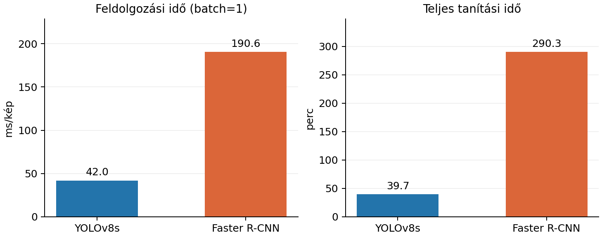
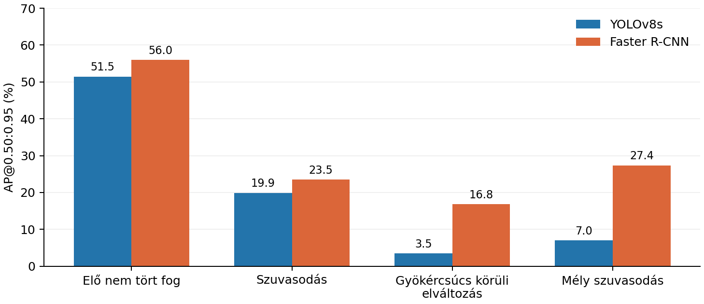
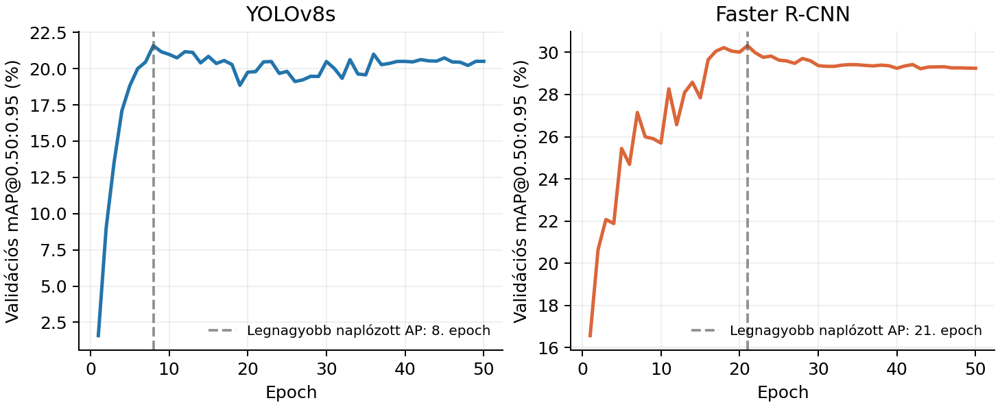
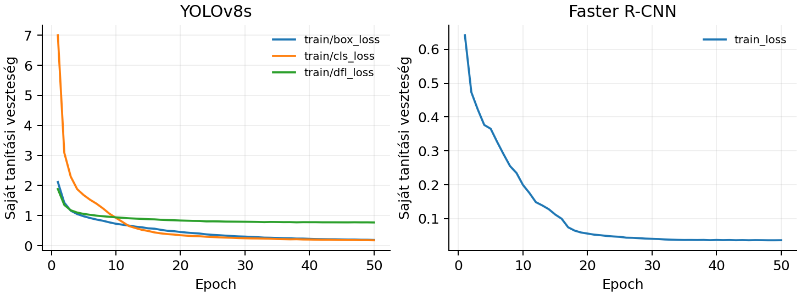
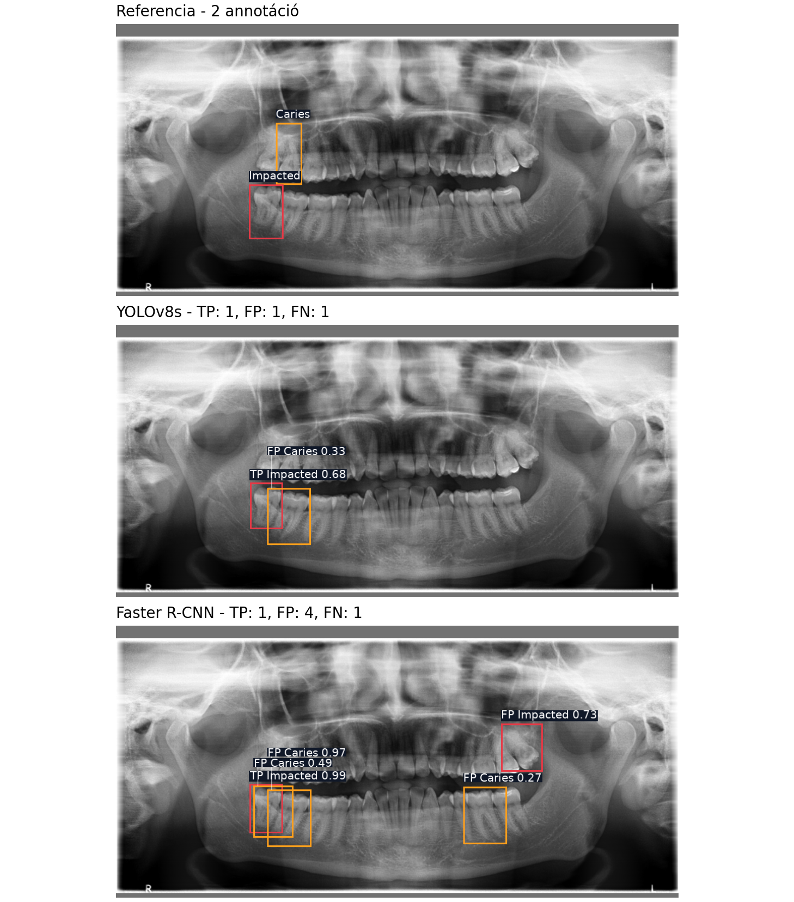
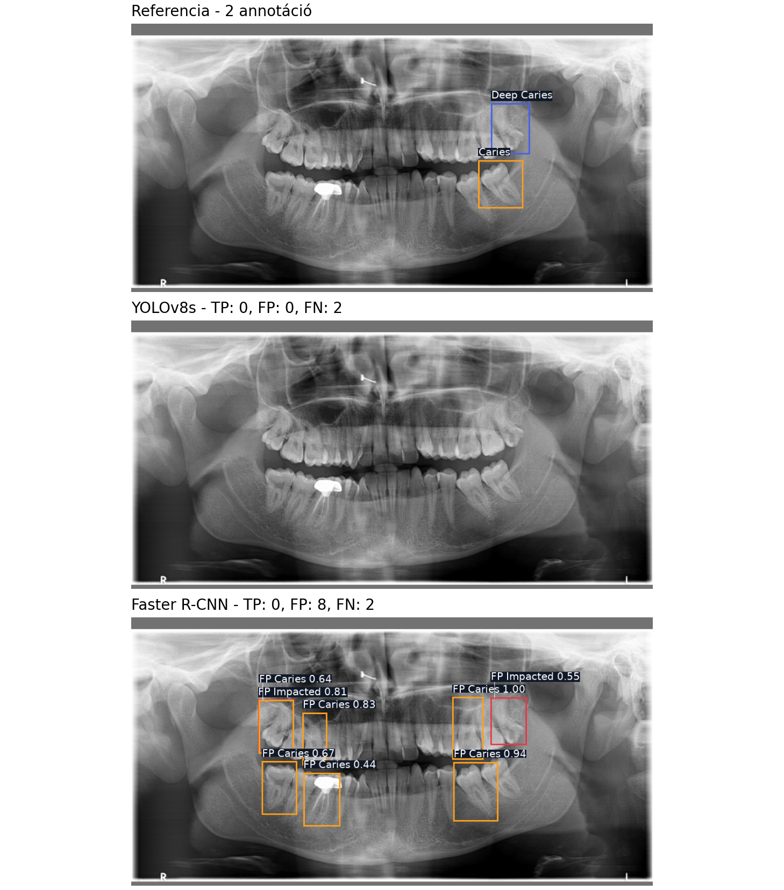
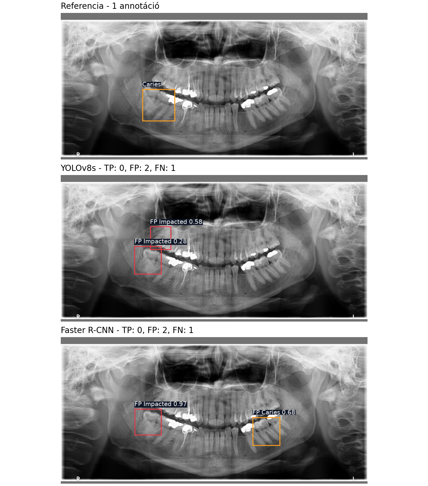

# Fogászati röntgenképek elemzése mesterséges intelligenciával

YOLOv8s és Faster R-CNN összehasonlítása a DENTEX adathalmazon

| Adat | Érték |
| --- | --- |
| Szerző | Kitöltendő |
| Egyetem / szak | Kitöltendő |
| Tantárgy | Kitöltendő |
| Kísérlet dátuma | 2026. október 13. |

## Összefoglaló

A projekt célja négy fogászati eltéréssel megjelölt fog lokalizálása panorámaröntgeneken. Két előtanított objektumdetektort finomhangoltunk ugyanazon a 493 tanítóképen: YOLOv8s és Faster R-CNN ResNet-50 FPN. Modellválasztásra 106 validációs képet, végső összehasonlításra további 106, a tanításból kihagyott tesztképet használtunk.

A közös COCO kiértékelővel mért teszt mAP@0.50:0.95 a YOLO esetén 20,46%, a Faster R-CNN esetén 30,90%. A Faster R-CNN ebben a kísérletben jobb detektálási eredményt adott, míg a YOLO 4.54-szer gyorsabban dolgozott fel egy képet. A teljes tanítási idő rendre 0 óra 39 perc 44 mp és 4 óra 50 perc 15 mp volt.

A kész rendszer képenként kereteket, osztálycímkéket és pontszámokat ad. Nem állít elő szöveges orvosi leletet, nem végez fogszámozást, és az eredmény nem tekinthető klinikai diagnózisnak. Az mAP detektálási mérőszám, nem egyszerű osztályozási találati arány.

A beszámoló a már befejezett tanítások naplóiból és mentett tesztpredikcióiból készült. Elkészítéséhez nem történt új tanítás.

---

## 1. Adathalmaz és feladat

A DENTEX hierarchikus annotációkat tartalmaz: kvadráns, fogazonosítás és diagnózis. A feladathoz a training_data/quadrant-enumeration-disease részhalmazt használtuk, 705 képpel és 3529 annotációval. A quadrant, quadrant_enumeration és unlabelled almappák nem kerültek a diagnózisdetektorok tanításába. Forrás: a DENTEX készítőinek leírása és a helyi train_quadrant_enumeration_disease.json [1, 2].

| Diagnózis | Tanító | Validáció | Teszt |
| --- | --- | --- | --- |
| Elő nem tört fog | 414 | 89 | 101 |
| Szuvasodás | 1546 | 297 | 346 |
| Gyökércsúcs körüli elváltozás | 117 | 25 | 16 |
| Mély szuvasodás | 374 | 103 | 101 |
| Összes annotáció | 2451 | 514 | 564 |
| Képek száma | 493 | 106 | 106 |

A felosztás 70/15/15 arányú, képszintű, seed=42 véletlenmaggal. A pontos képazonosítókat a manifest.json rögzíti. A három halmaz diszjunkt. A betegazonosítók hiánya miatt ez nem bizonyítottan betegszintű szétválasztás; ugyanazon beteg eltérő felvételeinek esetleges átfedése nem zárható ki.

A tanítóhalmazban a szuvasodás 1546, a gyökércsúcs körüli elváltozás 117 annotációt kapott: az osztályeloszlás erősen egyenlőtlen. A tesztben az utóbbi osztályhoz mindössze 16 annotáció tartozik, ezért ennél az osztálynál különösen bizonytalan az eredmény általánosíthatósága.

Előfeldolgozás: minden képet RGB-re alakítunk, aránytartóan átméretezünk, majd 1024x1024-es, 114-es szürke kitöltésű vászonra helyezünk. A keretek ugyanazzal a méretezéssel és eltolással alakulnak át. Mindkét modell ugyanazokat az előkészített PNG fájlokat kapja. A YOLO normalizált középpont-szélesség-magasság formátumot, a Faster R-CNN xyxy kereteket használ.

Adatminőségi megjegyzés: az egy kép/osztály/keret kombináció szerint ismétlődő annotációk száma train/val/test sorrendben 0/1/0. A validációban lévő egy ismétlődő jelölést a YOLO betöltője összevonja (513 jelölés), a közös JSON 514-et tartalmaz. A végső tesztben nincs ilyen eltérés. Az eredeti tanításokat és címkéket utólag nem módosítottuk.

---

## 2. Módszerek és kísérleti beállítások

A YOLOv8s egyfázisú detektor: a hálózat egyetlen feldolgozási láncban becsül kereteket és osztályokat. A Faster R-CNN kétfázisú: az RPN régiójavaslatokat készít, majd a régiónkénti fej osztályoz és pontosítja a kereteket. A ResNet-50 FPN több léptékű jellemzőtérképeket biztosít. Mindkét modell COCO-n előtanított súlyokból indul [3, 4].

| Beállítás | YOLOv8s | Faster R-CNN |
| --- | --- | --- |
| Bemenet | 1024x1024 | 1024x1024 |
| Epoch | 50 | 50 |
| Batch | 4 | 2 |
| Optimalizáló | SGD, momentum 0.937 | SGD, momentum 0.9 |
| Kezdeti learning rate | 0.001 | 0.005 |
| Ütemezés | Ultralytics alapütemezés, warmup | StepLR: 16 epochonként x0.1 |
| Előtanítás | COCO | COCO |
| Augmentáció | A megadott geometriai/színaugmentációk kikapcsolva | Nincs |
| Kevert pontosság | AMP bekapcsolva | FP32 |
| Modellválasztás | Ultralytics validációs fitness | Közös validációs mAP@0.50:0.95 |

Hardver: NVIDIA GeForce RTX 3050 6GB Laptop GPU, 6 GB VRAM; Windows, Python 3.10.4; PyTorch 2.5.1+cu121, Torchvision 0.20.1+cu121, Ultralytics 8.4.175. A tanítások seed=42 beállítással és egymás után futottak. A teljes, aktuálisan rögzített csomaglista a reports/environment.txt fájlban található; ez a beszámoló készítésekor mentett környezet.

A két eljárás tanítási ütemezése, batchmérete és numerikus pontossága eltér. Azonos epochsám ezért nem azonos számítási költség vagy teljesen kontrollált architektúra-összehasonlítás. Az eredmények a megadott konfigurációkra vonatkoznak; nem bizonyítják valamelyik módszer általános fölényét.

Kiértékelés: osztályhelyes keretillesztés; COCO AP 0.50-től 0.95-ig, 0.05 lépésű IoU-küszöbökkel. A pontszám alsó határa AP-hoz 0.001, az NMS IoU-küszöbe 0.5, a maximális detekciószám 100. Precision/recall/F1: rögzített 0.25 pontszámküszöb és IoU legalább 0.5, képenként és osztályonként egy-egy párosítással. A tesztet nem használtuk küszöbhangolásra.

---

## 3. A közös teszt eredményei

| Mérőszám | YOLOv8s | Faster R-CNN |
| --- | --- | --- |
| mAP@0.50:0.95 | 20,46% | 30,90% |
| mAP@0.50 | 31,36% | 48,69% |
| mAP@0.75 | 23,80% | 36,62% |
| Precision (0.25) | 44,64% | 47,16% |
| Recall (0.25) | 26,60% | 55,85% |
| F1 (0.25) | 33,33% | 51,14% |
| Átlagos késleltetés | 41,99 ms/kép | 190,56 ms/kép |
| Teljes tanítási idő | 0 óra 39 perc 44 mp | 4 óra 50 perc 15 mp |
| Paraméterszám | 11,14 millió | 41,37 millió |

1. ábra. Feldolgozási és teljes tanítási idő a tényleges naplókból.

A Faster R-CNN mAP@0.50:0.95 előnye 10,44 százalékpont. A recall különbsége 29,26 százalékpont a rögzített működési ponton. A jobb érzékenység több téves jelöléssel is jár: a Faster R-CNN 353, a YOLO 186 téves pozitív detekciót adott.

A késleltetés batch=1 mellett, három bemelegítő futás után, GPU-szinkronizálással készült. Tartalmazza az elő-/utófeldolgozást és adatátvitelt, a lemezolvasást nem. Egyetlen mérés átlaga, nem több független futás statisztikai eredménye. A mentett fájlméret nem tiszta modellméret: a Faster R-CNN ellenőrzőpont optimalizálóállapotot is tartalmaz.

---

## 4. Osztályonkénti eredmények és hibák

2. ábra. Osztályonkénti AP@0.50:0.95 a 106 tesztképen.

| Osztály / modell | TP | FP | FN | Precision | Recall |
| --- | --- | --- | --- | --- | --- |
| Impacted / YOLO | 83 | 22 | 18 | 79,05% | 82,18% |
| Caries / YOLO | 59 | 146 | 287 | 28,78% | 17,05% |
| Periapical Lesion / YOLO | 0 | 2 | 16 | 0,00% | 0,00% |
| Deep Caries / YOLO | 8 | 16 | 93 | 33,33% | 7,92% |
| Impacted / FRCNN | 94 | 31 | 7 | 75,20% | 93,07% |
| Caries / FRCNN | 174 | 284 | 172 | 37,99% | 50,29% |
| Periapical Lesion / FRCNN | 4 | 13 | 12 | 23,53% | 25,00% |
| Deep Caries / FRCNN | 43 | 25 | 58 | 63,24% | 42,57% |

TP: helyesen lokalizált és helyesen osztályozott jelölés. FP: nem párosítható predikció; lehet hibás osztály, elégtelen térbeli átfedés, duplikált detekció vagy annotáció nélküli terület. FN: a rögzített küszöbnél meg nem talált annotáció. Ezek detektálási hibák, önmagukban nem klinikai tévedéskategóriák.

Mindkét modell az elő nem tört fog osztályában érte el a legmagasabb AP-t. A Faster R-CNN mind a négy osztály AP-jában jobb volt ebben a futásban; a mély szuvasodásnál és a gyökércsúcs körüli elváltozásnál nagyobb a különbség. Az eltérések okát e kísérlet nem választja szét: közrejátszhat a hálózat, az optimalizálás és az egyenlőtlen osztályeloszlás is.

A YOLO a gyökércsúcs körüli elváltozásokból a 0.25-ös küszöbnél egyet sem párosított helyesen. Az osztály AP-ja ettől még nem nulla, mert az AP számítása a 0.001-ig megtartott, alacsonyabb pontszámú predikciókat is figyelembe veszi. A fix küszöbnél mért recall és az AP eltérő kérdésre válaszol.

---

## 5. Tanulási görbék és modellválasztás

3. ábra. A tanítás során naplózott validációs mAP. A YOLO saját, a Faster R-CNN közös kiértékelőt használ; a görbék ezért nem teljesen azonos mérési eljárást ábrázolnak.

4. ábra. Saját tanítási veszteségek. A különböző loss-függvények abszolút értékei a két hálózat között nem hasonlíthatók közvetlenül.

Mindkét tanítás befejezte az 50 epochot. A Faster R-CNN legjobb validációs eredménye a 21. epochban 30,32%; ezt a best.pth őrzi. A YOLO naplózott validációs mAP maximuma a 8. epochban található; a teszteléshez az Ultralytics által mentett best.pt került betöltésre.

A Faster R-CNN későbbi epochjai nem javították tovább a validációs maximumot, miközben a tanítási veszteség alacsony maradt. Ez a mintázat összeegyeztethető túltanulással vagy validációs ingadozással, de önmagában nem bizonyítja az okot. A best ellenőrzőpont választása biztosítja, hogy nem szükségszerűen az utolsó epoch modelljét értékeljük.

Új tanítás a projekt lezárásához nem szükséges. A további elemzések és példák a mentett predikciókból állnak elő; a súlyok és a felosztás változatlanok maradnak.

---

## 6.1. Képes példa - tesztazonosító: 370

A manifest szerinti első három tesztkép egyikét mutatjuk; a példákat nem teljesítmény szerint válogattuk. Felül a referencia, alatta a két modell 0.25 feletti pontszámú detekciói láthatók. A jobb olvashatóságért a szürke paddinget levágtuk; az eredeti predikciókat nem módosítottuk.

5. ábra. Azonos kép és azonos működési pont. TP/FP: a megjelenített predikció párosítása; FN: a hiányzó referenciák darabszáma a panel címében.

A 2 referenciából a YOLO 1, a Faster R-CNN 1 jelölést talált meg. A téves pozitív jelölések száma rendre 1 és 4. Ez egy képre vonatkozó leírás; az összesített következtetés a teljes teszthalmazon alapul.

---

## 6.2. Képes példa - tesztazonosító: 65

A manifest szerinti első három tesztkép egyikét mutatjuk; a példákat nem teljesítmény szerint válogattuk. Felül a referencia, alatta a két modell 0.25 feletti pontszámú detekciói láthatók. A jobb olvashatóságért a szürke paddinget levágtuk; az eredeti predikciókat nem módosítottuk.

6. ábra. Azonos kép és azonos működési pont. TP/FP: a megjelenített predikció párosítása; FN: a hiányzó referenciák darabszáma a panel címében.

A 2 referenciából a YOLO 0, a Faster R-CNN 0 jelölést talált meg. A téves pozitív jelölések száma rendre 0 és 8. Ez egy képre vonatkozó leírás; az összesített következtetés a teljes teszthalmazon alapul.

---

## 6.3. Képes példa - tesztazonosító: 93

A manifest szerinti első három tesztkép egyikét mutatjuk; a példákat nem teljesítmény szerint válogattuk. Felül a referencia, alatta a két modell 0.25 feletti pontszámú detekciói láthatók. A jobb olvashatóságért a szürke paddinget levágtuk; az eredeti predikciókat nem módosítottuk.

7. ábra. Azonos kép és azonos működési pont. TP/FP: a megjelenített predikció párosítása; FN: a hiányzó referenciák darabszáma a panel címében.

A 1 referenciából a YOLO 0, a Faster R-CNN 0 jelölést talált meg. A téves pozitív jelölések száma rendre 2 és 2. Ez egy képre vonatkozó leírás; az összesített következtetés a teljes teszthalmazon alapul.

---

## 7. Következtetések és korlátok

Az elvégzett kísérlet megvalósította a négy diagnózisosztályhoz tartozó fogak lokalizálását két külön megoldással. A Faster R-CNN magasabb mAP-t és recallt adott, a YOLO rövidebb tanítási időt és kisebb képenkénti késleltetést ért el. Ha az adott kísérletben a detektálási eredmény az elsődleges, a Faster R-CNN a kedvezőbb; ha a sebesség és az erőforrásigény fontos, a YOLO előnyös. Egyik modell sem teljesít elég megbízhatóan ahhoz, hogy emberi ellenőrzés nélkül diagnosztikai döntést hozzon.

A következtetések korlátai: egy véletlenmag és egy adatfelosztás; betegszintű elkülönítés nem igazolt; ritka diagnózisok kevés tesztannotációval; eltérő batch, tanítási ütemezés és AMP; egyetlen késleltetésmérés; validációs annotációban egy duplikáció. A végső teszt mindkét módszernél ugyanazt az annotációt és kiértékelőt használta. A pontszámok nincsenek klinikai valószínűségként kalibrálva.

A jövőbeli munka lehet betegszintű és több seedes kísérlet, előre rögzített augmentáció, ritka osztályok célzott kezelése vagy a learning rate validációs hangolása. Ezek fejlesztési lehetőségek, nem elvégzett kísérletek és nem feltételei a jelen projekt befejezésének.

## 8. Reprodukálhatóság és bemutatás

A teljes forrás, konfiguráció, modellmetaadat, tanítási napló, tesztpredikció és SHA-256 ellenőrzés megmaradt. A reports/analysis.json rögzíti a súlyok és felosztások ellenőrzését; a reports/per_class_errors.csv az osztályonkénti hibákat. A build_report.py kizárólag mentett eredményeket elemez, nem tanít hálózatot.

Bemutatás új tanítás nélkül: a README.md parancsaival egy képet a predict.py dolgoz fel a best.pt vagy best.pth fájlból. A kimenet jelölt kép és eredeti koordinátás JSON. A beszámoló újragenerálása: python build_report.py. Az előtanított súlyok megléte után az inferencia és a kiértékelés offline is futtatható.

## Hivatkozások és felhasználás

[1] Hamamci és mtsai. (2023): DENTEX: An Abnormal Tooth Detection with Dental Enumeration and Diagnosis Benchmark for Panoramic X-rays. https://arxiv.org/abs/2305.19112

[2] DENTEX hivatalos projekt és adatlicenc (CC BY-NC-SA 4.0). https://github.com/ibrahimethemhamamci/DENTEX ; adat: https://zenodo.org/records/7812323

[3] Ultralytics YOLO tanítás és validáció. https://docs.ultralytics.com/modes/train/ ; https://docs.ultralytics.com/modes/val/

[4] Torchvision Faster R-CNN API. https://docs.pytorch.org/vision/stable/models/generated/torchvision.models.detection.fasterrcnn_resnet50_fpn.html

A forrásadatok és a belőlük készült képes példák nem kereskedelmi felhasználásánál a DENTEX adatlicencét, a modellek és könyvtárak esetén azok saját licencfeltételeit kell követni.
